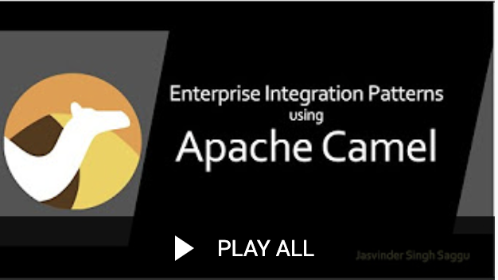

# Camel Playground


A single Spring Boot application that bundles a collection of small, self-contained Apache Camel
routes. Each one demonstrates one integration pattern or component: EIPs (content-based router,
splitter, aggregator, multicast, wire tap, composed message processor), error handling, RabbitMQ,
JMS/ActiveMQ, Kafka, NATS, the SAGA pattern, a Resilience4j circuit breaker, the REST DSL, metrics
(Prometheus / Grafana) and OpenTelemetry tracing.

Routes are switched on individually with feature flags. See [Enabling routes](#enabling-routes).

The accompanying tutorial videos are on the
[Saggu.uk YouTube channel](https://www.youtube.com/playlist?list=PLYwGWvgqiQCnRUzcdP1h6l-d9fRjP-Ed7).

[](https://www.youtube.com/playlist?list=PLYwGWvgqiQCnRUzcdP1h6l-d9fRjP-Ed7)

---

## Contents

- [Quick start](#quick-start)
- [Tech stack](#tech-stack)
- [Route catalogue](#route-catalogue)
- [Enabling routes](#enabling-routes)
- [HTTP endpoints](#http-endpoints)
- [Backing services (Docker)](#backing-services-docker)
- [Tests](#tests)
- [Development](#development)
- [Project layout](#project-layout)

---

## Quick start

**Prerequisites**

- **JDK 27 or newer** (`java -version` should report 27+). On macOS: `brew install openjdk`.
- **Maven 3.9+** (`brew install maven`). There is no Maven wrapper.
- **Docker** is optional. It is only needed for the Testcontainers integration test and for the
  [backing services](#backing-services-docker) that some routes talk to.

**Build and run**

```bash
mvn clean package                                   # compile, format check, tests -> target/camel-tutorial.jar
java -jar target/camel-tutorial.jar --jss.camel.rabbitmq.enabled=false
```

The app listens on **http://localhost:8080**. Check it is up with
`curl http://localhost:8080/actuator/health`.

> **Why `--jss.camel.rabbitmq.enabled=false`?** The RabbitMQ routes are the only ones switched on
> in `application.yml`, so by default the app expects a RabbitMQ broker and route startup fails
> without one. Either turn them off as above or [start RabbitMQ](#rabbitmq) first.

You can also run it with `mvn spring-boot:run` (pass flags with
`-Dspring-boot.run.arguments=--jss.camel.rabbitmq.enabled=false`).

---

## Tech stack

| | Version |
|---|---|
| Java | 27 |
| Spring Boot | 4.1.x (Spring Framework 7, Jakarta EE 11, Jackson 3) |
| Apache Camel | 4.22.x (LTS) |
| Build | Maven 3.9+ |
| Tests | JUnit 6, `camel-test-junit6`, Testcontainers 2.x |
| Formatting | Spotless with google-java-format (AOSP style) |

---

## Route catalogue

Every demo, its feature flag (under `jss.camel.` — see [Enabling routes](#enabling-routes)) and
what it needs to run. Source lives under `src/main/java/com/jss/routes/`.

### Core and EIPs

| Demo | Class | Flag | Needs |
|---|---|---|---|
| Hello / direct routes | `HelloRoute` | `hello` | — |
| SEDA (async queue, multiple consumers) | `seda/SedaRoute` | `seda` | — |
| File in / file out with masking | `FileHandlerRoute`, `MaskSensitiveInfo` | `file` | local directories set in the class |
| Content-based router (`choice`) | `contentbasedrouter/ChoiceRoute` | `choice` | — |
| Aggregator | `aggregation/AggregatorRoute` | `aggregator` | — |
| Multicast | `MulticastRoute` | `multicast` | — |
| Wire tap (with audit copy) | `wiretap/Wiretap` | `wiretap` | [RabbitMQ](#rabbitmq) |
| Composed message processor | `ComposedMessageProcessor` | — (test only) | — |
| Splitter | `SplitterRouteTest` | — (test only) | — |

### Error handling

All four run together under the single `error-handlers` flag, so you can compare the approaches
side by side in the log.

| Demo | Class |
|---|---|
| Dead-letter channel error handler | `errorhandlers/ErrorHandlerRoute` |
| `onException` | `errorhandlers/OnExceptionRoute` |
| `doTry` / `doCatch` | `errorhandlers/TryCatchRoute` |
| Shared `direct:exceptionHandler` the others send failures to | `errorhandlers/CommonErrorHandlerRoute` |

### Messaging

| Demo | Class | Flag | Needs |
|---|---|---|---|
| RabbitMQ weather publish/consume + REST | `rabbitmq/WeatherRoute`, `rest/RestDslWithRabbit` | `rabbitmq` (**on by default**) | [RabbitMQ](#rabbitmq) |
| RabbitMQ throttler | `rabbitmq/ThrottlerRoute` | `rabbitmq-throttler` | RabbitMQ |
| RabbitMQ stress tester | `rabbitmq/RabbitmqStressTesterRoute` | `rabbitmq-stress-tester` | RabbitMQ |
| Kafka stock prices | `kafka/StockKafkaRoute` | `kafka` | Kafka on `localhost:29092` |
| JMS over ActiveMQ | `jms/JMSRoute` | `jms` | ActiveMQ on `localhost:61616` |
| NATS order pipeline | `nats/OrderManagementSystemRoute` | `nats` | NATS on `localhost:4222` |

Shared RabbitMQ exchange, queue and routing-key names live in `rabbitmq/RabbitmqConfiguration.java`.

### REST, resilience and transactions

| Demo | Class | Flag | Needs |
|---|---|---|---|
| REST DSL (weather API) | `rest/RestDsl` | `rest-dsl` | — |
| REST via the Java `rest:` endpoint | `rest/RestJavaDsl` | `rest-java-dsl` | — |
| REST endpoint with Micrometer metrics | `rest/RestForMetrics` | `rest-metrics` | — |
| Resilience4j circuit breaker | `CircuitBreaker` | `circuit-breaker` | calls the app's own `/hello` |
| SAGA (in-memory saga service) | `saga/SagaRoute`, `saga/OrderController` | `saga` | — |

> `rest-dsl` and `rabbitmq` both register `GET/POST /services/weather...`, so enable only one of
> them at a time.

`config/CamelConfiguration` (Micrometer route policy and message history) loads when both
`rest-metrics` and `rabbitmq` are on.

---

## Enabling routes

Each route `@Component` (and most `@Configuration` classes) is gated by
`@ConditionalOnProperty(name = "jss.camel.<feature>.enabled", havingValue = "true")`. The flags
live under `jss.camel` in `src/main/resources/application.yml`, which acts as the control panel.
Only `rabbitmq` is `true` out of the box.

Turn a route on in any of these ways:

```bash
# 1. edit application.yml
#      jss.camel.hello.enabled: true

# 2. Spring command-line argument
java -jar target/camel-tutorial.jar --jss.camel.hello.enabled=true

# 3. JVM system property
java -Djss.camel.hello.enabled=true -jar target/camel-tutorial.jar
```

Some flags (`choice`, `aggregator`, `multicast`) are not listed in
`application.yml`. They are off until you set them. To find the flag for any class, look at its
`@ConditionalOnProperty` annotation.

---

## HTTP endpoints

Camel REST routes are served by `camel-servlet` under the **`/services`** context path
(`camel.servlet.mapping.context-path` in `application.yml`).

| Endpoint | Enabled by | Purpose |
|---|---|---|
| `GET /hello?sleepTimeMills=1000` | always | Spring MVC ping that sleeps a random 0–N ms |
| `GET /services/weather/{city}` | `rest-dsl` or `rabbitmq` | Fetch weather for a city |
| `POST /services/weather` | `rest-dsl` or `rabbitmq` | Save weather data (with `rabbitmq`, also publishes to RabbitMQ) |
| `GET /services/api-doc` | `rest-dsl` | OpenAPI document for the REST DSL |
| `GET /services/javadsl/weather/{city}` | `rest-java-dsl` | Weather via the Java `rest:` endpoint |
| `POST /services/javadsl/weather` | `rest-java-dsl` | Save weather via the Java `rest:` endpoint |
| `GET /services/dates` | `rest-metrics` | Sample endpoint for metrics |
| `POST /services/orders` | `saga` | Place an order (runs the saga) |
| `GET /services/databases` | `saga` | Inspect in-memory account, order and status state |
| `GET /actuator/health` | always | Health, with liveness and readiness probes |
| `GET /actuator/prometheus` | always | Prometheus metrics |
| `GET /actuator/info` | always | Build info |

---

## Backing services (Docker)

All compose files are in `src/main/resources/docker/`. Run the commands below from the repository
root.

| Service | Command | Ports |
|---|---|---|
| RabbitMQ (plain) | `docker compose -f src/main/resources/docker/rabbit-docker-compose.yml up -d` | 5672, UI 15672 |
| RabbitMQ (TLS) | `docker compose -f src/main/resources/docker/docker-compose.yml up -d rabbitmq` | 5671 (AMQPS), 5672, UI 15672 |
| Kafka + Zookeeper | `docker compose -f src/main/resources/docker/kafka-docker-compose.yml up -d` | 29092 |
| ActiveMQ | `docker compose -f src/main/resources/docker/docker-compose.yml up -d activemq` | 61616, console 8161 |
| NATS | `docker compose -f src/main/resources/docker/docker-compose.yml up -d nats` | 4222, monitoring 8222 |
| OpenTelemetry collector + Jaeger | `docker compose -f src/main/resources/docker/docker-compose.yml up -d otel` | 4317, Jaeger UI 16686 |
| Prometheus + Grafana + app | see [Metrics](#metrics-prometheus--grafana) | 9090, 3000, 8080 |

`docker-compose.yml` also defines Postgres (5432) and Tomcat (8080) services. Its `nats-webui`
service uses port 9090, the same as Prometheus, so don't run both.

### RabbitMQ

`application.yml` points at `localhost:5671` with `spring.rabbitmq.ssl.enabled: false`. Pick
whichever broker you started and override to match:

```bash
# plain broker (rabbit-docker-compose.yml)
java -jar target/camel-tutorial.jar --spring.rabbitmq.port=5672

# TLS broker (docker-compose.yml rabbitmq service)
java -jar target/camel-tutorial.jar --spring.rabbitmq.ssl.enabled=true
```

The management UI is at http://localhost:15672 (`guest` / `guest`).

#### TLS certificates

The TLS broker mounts `src/main/resources/docker/rabbitmq/rabbitmq.conf` and certificates from
`src/main/resources/docker/rabbitmq/certs/`. The certificate files are **git-ignored**
(`*.p12 *.crt *.key *.csr *.srl`), so generate them once:

```bash
mkdir -p src/main/resources/docker/rabbitmq/certs
cd src/main/resources/docker/rabbitmq/certs

# CA key and certificate
openssl genrsa -out ca.key 2048
openssl req -x509 -new -nodes -key ca.key -sha256 -days 1024 -out ca.crt -subj "/CN=MyCA"

# Server key and certificate signing request
openssl genrsa -out server.key 2048
openssl req -new -key server.key -out server.csr -subj "/CN=localhost"

# Sign the server cert with the CA
openssl x509 -req -in server.csr -CA ca.crt -CAkey ca.key -CAcreateserial \
  -out server.crt -days 365 -sha256

# Client trust store used by the application
keytool -import -alias rabbitmq -file ca.crt -keystore keystore.p12 \
  -storetype PKCS12 -storepass changeit -noprompt
```

The application reads the trust store through these properties, which are already set in
`application.yml` (only `ssl.enabled` needs to be switched to `true`):

```yaml
spring:
  rabbitmq:
    port: 5671
    ssl:
      enabled: true
      trust-store: classpath:docker/rabbitmq/certs/keystore.p12
      trust-store-password: changeit
      trust-store-type: PKCS12
```

### JMS / ActiveMQ

`jms/JMSConfiguration` creates its own `ActiveMQConnectionFactory` for `tcp://localhost:61616`, so
starting the `activemq` service and setting `jss.camel.jms.enabled=true` is enough. The
`spring.autoconfigure.exclude` entry in `application.yml` only matters if you add
`spring-boot-starter-activemq` to the build.

### Metrics (Prometheus + Grafana)

Camel and Spring metrics are exposed at `/actuator/prometheus`. To run the app, Prometheus and
Grafana together:

```bash
mvn clean install -DskipTests
docker build -t saggu/camel .
docker compose -f src/main/resources/docker/metrics-docker-compose.yml up -d
```

| Application | URL |
|---|---|
| App metrics | http://localhost:8080/actuator/prometheus |
| Prometheus | http://localhost:9090/ |
| Grafana (`admin` / `admin`) | http://localhost:3000/ |

A starter dashboard is in `src/main/resources/grafana/Camel-Dashboard.json`. Enable
`rest-metrics` (and `rabbitmq`) to switch on Camel's Micrometer route policy.

### OpenTelemetry tracing

Camel tracing uses `camel-opentelemetry2` (`@CamelOpenTelemetry2` on `CamelApplication`).

```bash
# 1. start an OTLP collector + Jaeger UI
docker compose -f src/main/resources/docker/docker-compose.yml up -d otel

# 2. run the app with the OpenTelemetry Java agent
#    download: https://github.com/open-telemetry/opentelemetry-java-instrumentation/releases
java -javaagent:/path/to/opentelemetry-javaagent.jar \
     -Dotel.traces.exporter=otlp \
     -Dotel.exporter.otlp.endpoint=http://localhost:4317 \
     -jar target/camel-tutorial.jar
```

View traces in the Jaeger UI at http://localhost:16686/.

---

## Tests

```bash
mvn test                                          # full suite
mvn test -Dtest=ChoiceRouteTest                   # one class
mvn test -Dtest=ChoiceRouteTest#givenGadgetOrderRequest_route_WillProcessGadgetOrder
mvn test -Dtest='!WeatherRouteTestcontainersTest' # skip the Docker-dependent test
```

- Route unit tests extend `org.apache.camel.test.junit6.CamelTestSupport` and build the route
  directly. Spring-context tests use `@CamelSpringBootTest` + `@SpringBootTest` and enable the
  flags they need through `properties = {...}`.
- `src/test/resources/application.properties` turns the RabbitMQ routes off so Spring-context tests
  don't need a broker.
- `WeatherRouteTestcontainersTest` starts RabbitMQ with Testcontainers and is **skipped
  automatically when Docker is not available**.
- `FileHandlerRouteTest` and `WeatherRouteTest` are `@Disabled`, so they always show as skipped.
- Surefire runs with `reuseForks=false` (a fresh JVM per test class) to keep the two test styles
  isolated.

---

## Development

- **Formatting is enforced.** Spotless (google-java-format, AOSP style) runs `check` during the
  `compile` phase on every `.java` file changed relative to `origin/main`. Run
  `mvn spotless:apply` before building. It also removes unused imports.
- **CI** (`.github/workflows/maven.yml`) runs `mvn -B package` on JDK 27 for pushes and pull
  requests to `main`.
- **Packaging.** The build produces `target/camel-tutorial.jar`. The app also extends
  `SpringBootServletInitializer` (Tomcat is `provided`), so it can be deployed as a WAR by
  switching `<packaging>` to `war` in `pom.xml`.

---

## Project layout

| Path | Contents |
|---|---|
| `src/main/java/com/jss/CamelApplication.java` | Spring Boot entry point |
| `src/main/java/com/jss/routes/**` | one package or class per pattern; the `RouteBuilder` is the entry point |
| `src/main/java/com/jss/config/`, `.../routes/*/*Configuration.java` | Camel / Spring beans, conditionally loaded |
| `src/main/java/com/jss/dto/` | Jackson / JAXB payload types |
| `src/main/java/com/jss/health/` | custom Actuator health indicators (examples, not registered) |
| `src/main/java/com/jss/experiment/` | scratch experiments, not part of the app |
| `src/main/resources/application.yml` | feature flags, thread pools, RabbitMQ/TLS, actuator, logging |
| `src/main/resources/camel-routes/routes.xml` | XML-DSL routes (empty placeholder) |
| `src/main/resources/docker/` | `docker compose` stacks and broker / collector config |
| `src/main/resources/grafana/` | Grafana dashboard JSON |
| `Dockerfile` | runtime image (`eclipse-temurin:21-jre`) for the metrics stack |

See [CLAUDE.md](CLAUDE.md) for a deeper architecture overview.
